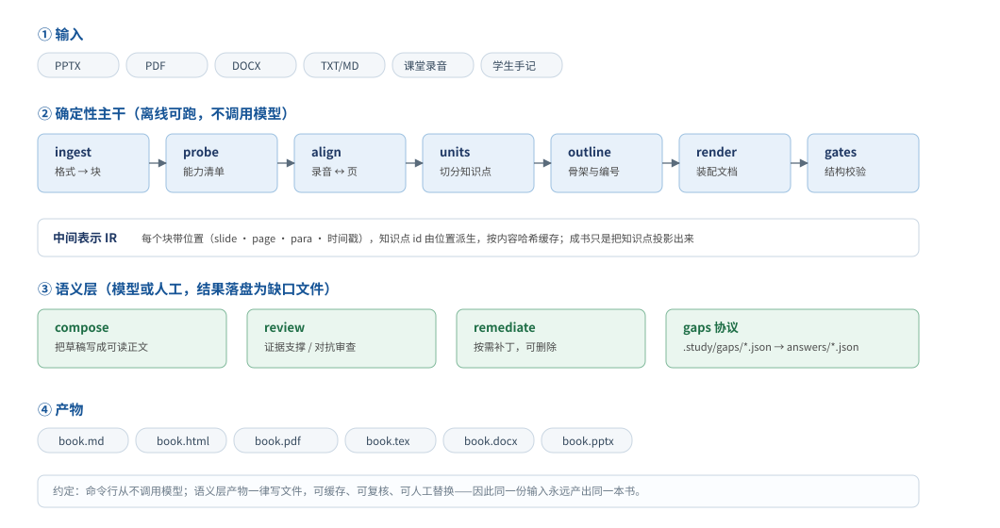

# course_press_harness

把一门课的多种学习素材，整理成**一本可以脱离原始材料独立阅读的连续文档**。

喂给它幻灯片、讲义 PDF、Word、纯文本、课堂录音和学生手记，得到的是一本有章节编号、
有公式排版、有对照表和算例的书——而不是一堆被拼接起来的原文。

> English version: [README.en.md](README.en.md)

> 状态：**v0.1 alpha**。已在真实课程素材上跑通：一百余页的演示文稿、四十余页的双栏 PDF、
> 两百余页的连续章节课件。内容质量取决于写作层，而写作层是模型的工作，通过缺口文件接入。



<sub>图 1　数据流：素材经确定性层整理为中间表示，写作层通过缺口文件介入，最终装配为多种格式的成书。</sub>

---

## 它和"AI 笔记工具"有什么不同

多数笔记工具把素材摊成一大段文本，让模型总结一遍。这样会丢掉两样后面一定会用到的东西：
**每句话出自哪里**，以及**加进第七讲时哪些内容被改动了**。

这个项目保留一层结构化中间表示——带定位符的块（`slide 12`、`00:13:40`、`page 37`）——
上面所有能力都建立在这层之上。带来的结果是：

- 管道**确定、可离线运行**，不接模型也能产出一本书
- 新增讲次是**追加**，不重写已有章节（实测：加第四讲后前三讲正文逐字节一致）
- 每条陈述都能追溯到证据（内部保留，是否呈现给读者是一项配置）
- 质量门禁检查的是结构，不是"感觉"

## 安装

```bash
uv venv .venv && uv pip install -e .
# 公式用 KaTeX 排版，首次检出需要装一次：
(cd tools && npm install)
```

可选依赖：`pdf`（PDF 摄取）、`docx`（Word 摄取）、`audio`（本地转写）。
PDF 输出需要本机有 Edge 或 Chrome。

## 快速开始

```bash
mkdir my-course && cd my-course
study init --course "示例课程"
cp ~/slides/lecture-06.pptx inputs/
$EDITOR study.config.yaml     # 声明讲次
study auto                    # 构建 + 生成审查任务 + 报告状态
$EDITOR .study/out/book.pdf
```

最小配置：

```yaml
schema_version: 1
course:
  name: 示例课程
  lang: zh
  lectures:
    - number: 6                 # 用 number，不要用 no：YAML 1.1 会把裸键 no 解析成 false
      title: 示例主题
      sources: [inputs/lecture-06.pptx]
compose:
  style: ""                     # 写作要求由你写，工具不预设文风
render:
  profile: learn                # learn | review
  source_references: none       # none | footnote | inline
```

## 命令

| 命令 | 作用 |
|---|---|
| `study init` | 建立工作区 |
| `study ingest` | 解析 `inputs/`，产出带定位符的块 |
| `study probe` | 报告素材能支撑到什么程度 |
| `study auto` | 一轮跑完：构建 → 审查任务 → 状态报告；退出码 5 表示"等你填答案" |
| `study build` | ingest → 知识点 → 骨架 → 渲染 → 门禁 |
| `study compose` | 写作层：把草稿写成可读正文（走缺口文件） |
| `study align` | 录音与幻灯片对齐（A/B/C 三档） |
| `study render` | 输出 `md` / `txt` / `tex` / `pdf` / `docx` / `pptx`，或 `--format all` |
| `study outline` | 查看或手工调整骨架 |
| `study review` | 生成 / 应用 / 查看语义审查 |
| `study explain` | 为某个知识点生成补充讲解补丁 |
| `study doctor` | 环境与工作区自检 |
| `study clean` | 清理派生数据（不动个人数据） |

退出码：`0` 正常，`1` 门禁失败，`2` 参数错误，`3` 输入缺失，`4` 内部错误，`5` 需要人工决定。

## 架构

四层，边界清晰：

```
输入 ──► 中间表示 IR ──► 知识单元 ──► 骨架 ──► 文档
        (带定位的块)    (缓存单位)   (编号)    md/pdf/docx…
                            ▲
                       写作层（模型或人工，走缺口文件）
```

**两条硬边界：**

1. **命令行从不调用模型。** 需要语义的地方产出缺口文件
   （`.study/gaps/<id>.json` → `answers/<id>.json`），任何 agent 或人都能填，
   管道本身离线可跑、结果可缓存、可复核。
2. **确定性层与语义层分离。** 摄取、对齐、切分、门禁、渲染全是脚本；
   只有写作与审查调用模型，且产物一律落盘。

阶段：

| 阶段 | 性质 | 产出 |
|---|---|---|
| ① ingest | 确定性 | `.study/sources/*.jsonl` |
| ② probe | 确定性 | 能力清单 |
| ③ align | 半确定性 | 录音片段 ↔ 页码 |
| ④ units | 确定性 | 知识点草稿 |
| ⑤ outline | 确定性 | `outline.json` |
| ⑥ compose | 语义层 | 正文 |
| ⑦ render | 确定性 | 成品文档 |
| ⑧ gates | 确定性 | 通过 / 不通过 |
| ⑨ review | 语义层 | findings 队列 |

## 模型从哪来

**这个仓库不包含任何 API 调用，也不需要 API key 就能跑完确定性部分。**
摄取、切分、编排、渲染、门禁全在本地完成；只有"把草稿写成可读正文"和"审查"这两步需要模型。

需要模型的地方，命令会**产出一个任务文件**而不是直接发请求：

```
.study/gaps/compose-<unit>.json      ← 任务：输入、规则、期望的答案格式
.study/gaps/answers/<id>.json        ← 答案：谁填都行
```

三种填法，任选：

**1. 让 agent 干（最省事）**

在 `my-course/` 目录下打开 Claude Code / Codex / 任何能读写文件的 agent，说：

> 读 `.study/gaps/*.json`，按每个文件的 `answer_format` 写出 `.study/gaps/answers/<id>.json`，
> 遵守里面的 rules，不要新增字段。

agent 用自己的额度调用自己的模型，harness 完全不碰网络。

**2. 用脚本调 API**

仓库带了一个标准库实现的脚本，只做两件事：把缺口喂给模型、把回答存成文件。

```bash
export ANTHROPIC_API_KEY=...          # 或 OPENAI_API_KEY
python tools/fill_gaps.py --workspace my-course --kind compose_unit --limit 5

# 只看会发送什么，不真正调用：
python tools/fill_gaps.py --workspace my-course --dry-run

# OpenAI 兼容端点（含本地 vLLM / Ollama）：
python tools/fill_gaps.py --workspace my-course --provider openai     --base-url http://localhost:8000/v1 --model local-model
```

脚本会校验回答：出现 `answer_format` 里没声明的字段就整条丢弃，避免模型自由发挥混进正文。

**3. 自己填**

文件就是 JSON，打开写就行。特征明显的图、少量疑难段落，人工填往往比调模型快。

填完执行：

```bash
study compose --apply          # 写回知识点
study review apply             # 应用审查结论
```

### 为什么不在 CLI 里直接调 API

三个理由：

- **可复现**：模型输出落盘成文件，同一份答案重跑得到同一本书；直接调 API 则每次都不同。
- **可选模型**：Claude、GPT、本地模型、人手都能填，工具不绑定任何供应商。
- **可审计**：每个知识点能追到"这句是哪个模型、哪次调用写的"，审查时能分清来源。

代价是你要多跑一步。`study auto` 会在结束时列出还差多少个缺口、哪些类型，填完再跑一次即可。

## 服务模式：网页 + 对话 + 自动出成品

上面的命令行是**库**：不调模型、可离线、可测试。如果你不想"跑一遍再让 agent 填缺口"，
用服务模式——它把模型接进来，一条龙生成：

```bash
study serve --workspace my-course   # 打开 http://127.0.0.1:8765
```

模型在**网页里配置**，不用碰环境变量：

| 字段 | 说明 |
|---|---|
| 供应商 | Anthropic / OpenAI 兼容（含本地 vLLM、Ollama） |
| API Key | 只保存在服务进程内存里；勾「保存并记住」才写入 `.study/provider.json`（已被 git 忽略） |
| 模型 | 留空用默认（`claude-sonnet-5-5` / `gpt-4o`） |
| 端点 | OpenAI 兼容服务需要，例如 `http://localhost:8000/v1` |

面板上有「测试连接」，填错了会直接显示 401 之类的错误，不用等到生成时才发现。
也可以用环境变量（`ANTHROPIC_API_KEY` / `OPENAI_API_KEY`）作为默认值。

页面里能做四件事：

| 面板 | 作用 |
|---|---|
| ① 工作区与素材 | 建工作区、拖入 pptx/pdf/docx/录音，上传后自动登记为讲次 |
| ② 输出要求 | 勾选 PDF / Markdown / Word / PPT / LaTeX，选 learn 或 review，写文风要求 |
| 进度 | 实时日志（SSE），完成后出现下载链接 |
| 对话 | 直接说人话：「换成复习版，输出 PDF 和 Word」「这一讲太简略，重写详细点」 |

对话背后是**工具循环**，不是一次性问答：

```
你说：这一讲太碎，先补 20 个知识点再出 PDF
模型 → status            读工作区现状
模型 → prepare(limit=20) 生成写作任务
模型 → fill(limit=20)    调用模型逐条写作
模型 → apply             并入知识点
模型 → build → gate_report   自查：门禁有没有问题
模型 → inspect_unit(...)     有问题就把正文读回来判断
模型 → rewrite(unit, "把条目改写成连贯段落")   按意见重写
模型 → render(pdf)       产出成品
模型 → finish            汇报做了哪些、还差什么
```

模型自己决定顺序与参数；每一步的结果都会回喂给它，由它决定下一步。
可用工具：`status` `list_units` `inspect_unit` `gate_report` `ingest` `build`
`prepare` `fill` `apply` `rewrite` `render` `finish`。

三条硬约束：

- **可观察**：每次调用与结果写进 `.study/logs/agent-*.jsonl`，出问题能回放
- **有预算**：工具调用次数与缺口数量都有上限，用完必须汇报（默认 60 个知识点/轮）
- **要自查**：系统提示要求交付前先 `build` + `gate_report`，必要时读回正文再 `rewrite`

`--dry-run` 看提示词、`.study/logs/` 看模型到底做了什么。

### 它内部做了什么

```
上传素材 → 登记讲次 → study build（确定性）
        → 缺口文件 → 调用模型逐个填写 → compose --apply
        → 再 build 一次 → 渲染你勾选的格式 → 提供下载
```

每一步都还是走前面那套文件：缺口、知识点、outline。所以服务模式产出的书，和你在命令行
里手工填缺口得到的**完全一致**，只是不用你动手。

成本控制：一次运行最多合成 `max_units`（默认 60）个知识点，剩下的下次继续。
没有 API key 时不会报错——它会跳过模型合成，先用确定性草稿出一版，日志里会说明。

### 关于"命令行不调用模型"这条原则

它约束的是**库**（`study` 命令），目的是可复现、可测试、可离线。服务层是**产品**，
它调用模型并写回同一套文件。两者不冲突：同一个工作区，命令行跑一半、服务模式接着跑，
或者反过来，结果都一样。

## PDF 版式规范（默认值）

默认排版参数如下。想改，改 `src/course_press_harness/html_pdf.py` 顶部的 `CSS` 常量即可，
不涉及任何渲染逻辑。

| 项 | 默认值 |
|---|---|
| 纸张与页边距 | A4，22 mm（上/左右）/ 20 mm（下） |
| 正文字体 | 拉丁 Times New Roman，中文回落宋体；11 pt |
| 行距 | `line-height: 1.62`（实测行距约 18 pt，段间距约 21 pt） |
| 首行缩进 | 2 字，两端对齐 |
| 章标题 | 18 pt，加粗，`#165496`，前 20 pt / 后 12 pt |
| 节标题 | 13.5 pt，加粗，`#165496` |
| 三级标题 | 11.5 pt，加粗，**`#1E6E46`**（绿色，用来和章节区分） |
| 四级标题 | 10.5 pt，加粗，`#165496` |
| 表头 | 底色 `#E2E9F2`，字色 `#165496`，无竖线，上下各一条细线 |
| 定义框 | 底色 `#E8F1FA`，边框 `#9CC0E0`，标题条 `#5C88B6` 白字，圆角 7 pt |
| 提示框 | 底色 `#FDF0E6`，边框 `#F4B183`，标题条 `#BF6000` 白字 |
| 代码 | Consolas / Cascadia Mono，9.5 pt，浅灰底 |
| 公式 | KaTeX 渲染（`$...$` 与 `$$...$$`） |
| 图 | TikZ 先编译成 PNG 再嵌入，最大宽度 90% 版心 |

LaTeX 输出（`--format tex`）的版式在 `templates/learn/tex/manifest.yaml` 的 `preamble` 里，
同样可整段替换。

## 工作区

```
my-course/
├── study.config.yaml
├── inputs/                    原始素材，只读
└── .study/
    ├── sources/               中间表示（每块一行）
    ├── aligned/               对齐结果
    ├── knowledge/units/       知识点，跨讲共享，可手工编辑
    ├── outline.json           骨架，可手改，重跑不覆盖
    ├── gaps/                  缺口与答案
    ├── patches/               个人笔记与补丁，永不写入正文
    ├── review/                审查结果
    └── out/                   成品
```

`sources/`、`assets/`、`out/` 是派生物，可随时删除重建。
`patches/`、`review/`、`outline.json` 属于你的数据，任何命令都不会覆盖。

## 已验证的行为

- 一百余页的演示文稿能完整切分，结构与素材自带编号一致
- 标题写成普通文本框、页面还带页眉的素材也能识别出结构（否则整份只会析出一个知识点）
- 追加第四讲后，前三讲正文逐字节一致
- 手工调整大纲后重新构建，位置保持
- 相同输入重复构建，输出逐字节一致

细节与踩过的坑见 [docs/validation.md](docs/validation.md)。

## 设计文档

| 文件 | 内容 |
|---|---|
| [docs/architecture.md](docs/architecture.md) | 总纲：原则、阶段、数据契约、决策记录 |
| [docs/unit-schema.md](docs/unit-schema.md) | 知识点的字段与修订协议 |
| [docs/outline-generation.md](docs/outline-generation.md) | 分节算法、编号、三方合并 |
| [docs/ingest.md](docs/ingest.md) | 各格式适配器、块 id 稳定性、图片降级 |
| [docs/alignment.md](docs/alignment.md) | 录音对齐三档 |
| [docs/review-protocol.md](docs/review-protocol.md) | findings 格式与审查流程 |
| [docs/rendering.md](docs/rendering.md) | 模板、视图、输出格式、确定性 |
| [docs/glossary.md](docs/glossary.md) | 术语表与一致性检查 |
| [docs/cli.md](docs/cli.md) | 命令全集与配置 |
| [docs/state.md](docs/state.md) | 缓存、失效、用户数据保护 |

## 测试

```bash
python -m pytest
```

测试全部使用**现场生成的占位素材**，不依赖任何外部文件。覆盖：摄取与切分、门禁、
公式排版、录音对齐、缺口流转、渲染确定性与增量追加。

## 许可

MIT
