# 示例课程

## 目录

- 前言
- 第 2 讲 第02章+线性表
  - 2.1 线性表的定义
    - 2.1.1 线性表
    - 2.1.2 线性表：n 个数据元素的有限序列
  - 2.2 线性表的顺序表示和实现
  - 2.3 线性表的链式表示和实现
    - 2.3.1 链式存储的线性表
    - 2.3.2 其他线性链表
- 第 3 讲 第03章+栈和队列
  - 3.1 第 1 页起
    - 3.1.1 十进制正整数转十六进制字符串
    - 3.1.2 第3章 栈和队列
  - 3.2 栈的应用
    - 3.2.2 队列


# 第 2 讲 第02章+线性表

## 2.1 线性表的定义

### 2.1.1 线性表

**概念**

线性结构由若干元素组成，其中有一个唯一的头元素，一个唯一的尾元素。
除头元素外，其余元素均有一个直接前驱。
除尾元素外，其余元素均有一个直接后继。

**易错**

两条「除……外」分别落在表的两端：前驱这一条豁免头元素，后继这一条豁免尾元素，方向不要弄反。
头元素与尾元素的「唯一」不可省：一个线性结构里只能各有一个。

### 2.1.2 线性表：n 个数据元素的有限序列

**概念**

线性表是 $n$ 个数据元素的有限序列，写成 $(a_1,\ a_2,\ \dots,\ a_n)$。
其中 $a_1$ 是头元素，$a_n$ 是尾元素，$a_i$ 是第 $i$ 个元素。
$a_{i-1}$ 是 $a_i$ 的直接前驱，$a_i$ 是 $a_{i-1}$ 的直接后继：当 $2 \le i \le n$ 时，$a_i$ 有且只有一个直接前驱；当 $1 \le i \le n-1$ 时，$a_i$ 有且只有一个直接后继。由此，头元素没有直接前驱，尾元素没有直接后继，其余元素恰好各有一个前驱和一个后继。
线性表中的数据元素可以由若干个数据项组成：一个元素是一条记录，记录由若干数据项构成。
作为抽象数据类型，线性表由一个数据对象、一个数据关系和一组基本操作共同刻画：数据对象 $D=\{a_i \mid a_i \in \mathrm{ElemSet},\ i=1,2,\dots,n\}$；数据关系 $R_1=\{<a_{i-1},a_i> \mid a_{i-1},a_i \in D,\ i=1,2,\dots,n\}$。操作部分见“怎么用”。

**为什么需要**

线性表上的操作名目繁多，但真正需要单独定义的只是少数几个简单操作。
合并、拆分、复制等复杂操作，都可以由这些简单基本操作组合实现，因此不用为每个新需求再定义一个基本操作。

**怎么用**

构造与销毁：`InitList(&L)` 构造一个空的线性表 $L$；`DestroyList(&L)` 销毁线性表 $L$。
清空：`ClearList(&L)`，前提是线性表 $L$ 已存在，结果是将 $L$ 重置为空表。
判空与长度：`ListEmpty(L)` 判断是否为空；`ListLength(L)` 取长度。
取元素：`GetElem(L, i, &e)` 把 $L$ 中的第 $i$ 个元素返回到 $e$。
查找：`LocateElem(L, e, compare())` 借助比较函数 `compare()` 定位元素 $e$ 的位置。
找前驱和后继：`PriorElem(L, cur_e, &pre_e)` 求 `cur_e` 的前驱元素；`NextElem(L, cur_e, &next_e)` 求 `cur_e` 的后继元素。
插入与删除：`ListInsert(&L, i, e)` 在位置 $i$ 处插入元素；`ListDelete(&L, i, &e)` 删除位置 $i$ 处的元素。
遍历：`ListTraverse(L, visit())` 依次对每个元素执行 `visit()`。

**例子**

英文字母表 $(A, B, C, \dots, Z)$ 是一个线性表，每个元素就是一个字母。
登记表是元素由多个数据项组成的线性表。一条记录有姓名、学号、性别、年龄、班级这五个数据项，整张登记表就是这些记录构成的有限序列：
| 姓名 | 学号 | 性别 | 年龄 | 班级 |
| --- | --- | --- | --- | --- |
| 王晓林 | 790631 | 男 | 25 | 计90 |
| 陈红 | 790632 | 女 | 24 | 计90 |

**易错**

前驱、后继的“唯一”要条件，不要漏掉下标范围：只说 $a_i$ 有直接前驱之前，先看清楚 $2 \le i \le n$；只说有直接后继之前，先看清楚 $1 \le i \le n-1$。
$\mathrm{InitList}$、$\mathrm{ClearList}$、$\mathrm{DestroyList}$ 是三件不同的事，分别对应“构造空表”“把已有表重置为空表”“销毁表”；其中 $\mathrm{ClearList}$ 有前置条件，即线性表已存在。
带 `&` 的参数（如 `&L`、`&e`）是待带回结果的参数，与只读参数（如 `L`、`i`）在用法上不同。

## 2.2 线性表的顺序表示和实现

**概念**

线性表的顺序表示，是用一组地址连续的存储单元依次存放线性表中的数据元素，以元素在计算机内的「物理位置相邻」来表示数据元素之间「逻辑关系相邻」。
设每个元素占用 l 个存储单元，LOC(ai) 表示元素 ai 的存储地址。LOC(a1) 既是第一个数据元素的地址，也是整个线性表的起始地址。相邻元素的地址递推为 LOC(ai+1) = LOC(ai) + l，通式为 LOC(ai) = LOC(a1) + (i−1)l。
只要确定了起始地址，表中任一元素的地址都能由通式直接算出并立即存取，因此顺序存储结构又称随机存取存储结构。数组就是这种结构的一个现成例子。

**怎么用**

顺序表用一个结构体描述：一个指向存储区的指针 elem，一个记录当前表长的 length（初始为 0），一个记录存储容量（可容纳的元素个数）的 listsize。
初始化时按 LIST_INIT_SIZE 个元素申请空间，申请失败则按溢出处理并退出；成功后把 length 置 0、listsize 置为初始容量。
插入第 i 个位置：先判断 i 是否落在 1 到 length+1 之间；若 length 已等于 listsize，说明空间已满，需要按 LISTINCREMENT 追加容量重新分配存储区，重新分配失败同样按溢出处理，成功则把新地址写回 elem 并更新 listsize。随后把第 n 到第 i 个元素依次后移一个位置，腾出第 i 个位置放入新元素，最后表长加一。
删除第 i 个元素：先判断 i 是否落在 1 到 length 之间；取走第 i 个元素的值，把第 i+1 到第 n 个元素依次前移一个位置，最后表长减一。
按值查找可以把比较规则作为参数传进来：查找函数接收顺序表、待查元素和一个比较函数指针，从头依次比较，找到则返回位序，找不到返回 0。这样同一份查找代码可以适配不同的相等判定。

**例子**

设表中已有若干元素，在第 4 个元素之前插入 25：先把原来第 4 个及之后的元素整体后移一位，空出的第 4 个位置填入 25，表长加一。
删除第 4 个元素 25：先取出第 4 个位置上的 25 作为返回值，再把第 5 个及之后的元素整体前移一位，表长减一。

**易错**

插入时 i 的合法范围是 1 到 length+1（可插在表尾之后），删除时是 1 到 length；两者的上界不同，判据写错会在表尾插入或删空表时出错。
重新分配存储区返回的是新地址，必须写回 elem；只把返回值存进临时变量而忘记回写，后续访问仍是旧空间。重新分配失败要按溢出处理。
重新分配的含义是：若当前指针所在位置之后有足够的连续空间，就地扩大并返回原地址；若不够，则另按新长度分配一块空间，把原有数据整体拷贝过去，释放原存储区（原指针无需再手工释放），返回新存储区的首地址。因此原地址可能失效。
移动方向不能反：插入必须从表尾向第 i 个位置倒着后移，删除必须从第 i+1 个位置向表尾顺着前移，顺序反了会把尚未搬走的元素覆盖掉。
指针函数与函数指针不是一回事：指针函数是返回值为指针的函数，写作 int *f(int a, int b)；函数指针是指向函数的指针，写作 int (*f)(int a, int b)，用于按值查找时传入比较规则的是后者。函数指针的声明中那对括号不能省，否则就变成了指针函数。

## 2.3 线性表的链式表示和实现

### 2.3.1 链式存储的线性表

**概念**

链式存储结构用一组任意的存储单元存放线性表的数据元素，这些存储单元可以连续，也可以不连续。
每个结点由两部分信息组成：存放数据元素信息的数据域 `data`，以及存放直接后继存储位置信息的指针域（指针或链）。
头指针 `Head` 指向链表中的第一个结点；空指针记为 0，也写作 `NULL` 或 `∧`。
通常在第一个结点之前附加一个头结点，用来记录线性表的某些性质信息（如长度）。有了头结点，头指针指向头结点，`L->next == 0` 即为空表。
单链表的存储结构定义：
```c
typedef struct LNode {
    ElemType data;
    struct LNode *next;
} LNode, *LinkList;
```

**为什么需要**

与顺序存储相比，链式存储中数据元素的插入、删除相对方便，不必移动元素。
代价是：不可随机存取表中任意数据元素；也不可直接获取线性表的长度。
两种存储结构要放在同一组运算上比较：在指定位置插入元素、返回第 i 个元素、删除指定元素、获取列表长度、查找元素、找前驱、找后继。

**怎么用**

取第 i 个元素：从头结点后第一个结点出发，`p = L->next; j = 1;`，边走边计数，`while ( p && j < i ) { p = p->next; ++j; }`，循环结束若 `!p || j > i` 说明 i 小于 1 或越界，返回 ERROR，否则 `e = p->data`。时间为 O(n)。
插入：先找到第 i-1 个结点，再用 `s = (LNode *) malloc ( sizeof (LNode) )` 申请新结点并填入 `s->data = e`，最后改两条指针。
改指针的次序不能颠倒：
```c
s->next = p->next;  // 先让新结点接住原后继
p->next = s;        // 再让前驱指向新结点
```
反过来写，`s->next` 取到的已是 s 本身，链就断了。插入时间为 O(n)，耗时全在找第 i-1 个结点上。
删除：同样先找第 i-1 个结点，判断 `!p->next || j > i - 1` 则报错；随后 `q = p->next; p->next = q->next; e = q->data; free(q);`。时间 O(n)。注意定位循环的条件是 `p->next` 而非 `p`。
动态变量需要动态分配内存，删除结点后必须 `free` 归还。任何时刻，每个内存单元都要有指针牵住，否则会出现内存泄露或者非法访问。
建表（头插法）：先 `L = (LinkList) malloc ( sizeof (LNode) ); L->next = NULL;` 建立头结点，再循环 n 次，每读入一个元素就插在表头：
```c
p = (LNode *) malloc ( sizeof (LNode) );
scanf ( &p->data );
p->next = L->next;
L->next = p;
```
循环写成 `for ( i = n; i > 0; --i )`，得到的是按输入逆序排列的链表，总时间 O(n)。
合并两个有序单链表：令 `pa = La->next; pb = Lb->next;` 分别指向第一个结点，并令 `Lc = pc = La`，让 Lc 借用 La 的头结点、pc 指向 Lc 链尾；在 `while ( pa && pb )` 中比较 `pa->data` 与 `pb->data`，小的那个结点接到 pc 之后并把 pc 和相应指针后移；循环结束用 `pc->next = pa ? pa : pb;` 一次接上剩余部分，最后 `free (Lb)`。合并过程不申请新结点，直接改链。
两个线性表求并（扩展 La，把 Lb 中不在 La 里的元素插到 La 末尾）：依次取出 Lb 的元素，用 `LocateElem( La, e, equal )` 判断是否已在 La 中，不在则 `ListInsert( La, ++La_len, e )`。
两个有序线性表合并：i、j 分别指向 La、Lb 的当前元素，`while ( ( i <= La_len ) && ( j <= Lb_len ) )` 中把较小者插入 Lc，某一表取完后用两个 while 把另一表的剩余元素逐个插入。

**例子**

取第 3 个元素：表中依次为 Zhao、Qian、Sun，j 从 1 走到 3，p 停在 Sun 所在结点，`e = p->data = Sun`。
在第 3 个元素之前插入：j 只需走到 2（即 i-1），p 指向 Qian，新结点插在 Qian 与 Sun 之间。
删除第 3 个元素：j 停在 2（= 3 - 1），q 指向 Sun，`p->next = q->next` 后 Sun 脱链，`e = q->data = Sun`。
求并：La = (3, 13, 7, 9)、Lb = (5, 7, 10)，La_len = 4，Lb_len = 3。从 Lb 取 5，La 中没有，插入为第 5 个元素；取 7，在 La 中能找到，跳过；取 10，插入为第 6 个元素。
合并有序表：La = ( 3, 5, 8, 11 )，Lb = ( 2, 6, 8, 9, 11, 15, 20 )，合并得 Lc = ( 2, 3, 5, 6, 8, 8, 9, 11, 11, 15, 20 )。
另一组合并：La = ( 3, 5, 8 )，Lb = ( 2, 6, 8, 9, 15 )，合并得 Lc = ( 2, 3, 5, 6, 8, 8, 9, 15 )。
求并算法的时间为 O( ListLength(La) × ListLength(Lb) )，其前提是 GetElem() 和 ListInsert() 的执行时间与表长无关，而 LocateElem() 的执行时间与表长成正比。

**易错**

插入时把两条指针语句写反。必须先 `s->next = p->next`，再 `p->next = s`。
把删除写成 `p->next = p->next->next`。这样被删结点失去指针牵住，既取不出 `e`，也无法 `free`，导致内存泄露；并且没有判定 `p->next` 是否为空，会非法访问。
删除后忘记 `free(q)`：动态申请的内存不归还，同样造成内存泄露。调用删除操作之后，还要把取到的元素 `e` 交回调用者、把释放工作做完。
写插入或建表程序时只申请结点而不判定申请到的结点是否为空，就直接使用。
定位循环的判断对象容易混：取第 i 个元素用 `p && j < i`，删除定位前驱用 `p->next && j < i - 1`。

**自测**

在单链表中，如果在结点 p 之后插入一个新结点 s，其操作为（ ）。
A. `s->next = p->next; p->next = s;`
B. `p->next = s; s->next = p->next;`
C. `s->next = p; p->next = s->next;`
D. `p->next = s; s->next = p;`
求单链表中当前结点的后继和前驱的时间复杂度分别是（ ）。
A. O(n) 和 O(1)
B. O(1) 和 O(1)
C. O(1) 和 O(n)
D. O(n) 和 O(n)
在线性表的下列运算中，不改变数据元素之间结构关系的运算是（ ）。
A. 插入
B. 删除
C. 排序
D. 定位
链表不具有的特点是（ ）。
A. 插入、删除不需要移动元素
B. 可随机访问任一元素
C. 不必事先估计存储空间
D. 所需空间与线性长度成正比

### 2.3.2 其他线性链表

**概念**

静态链表是用一维数组描述的单链表：每个数组元素含 data 与 cur，cur 是游标，指示下一个元素在数组中的相对位置。
循环链表把表中最后一个结点的指针域指向头结点，使整个链表形成一个环。
双向链表的结点有两个指针域：prior 指向直接前趋，next 指向直接后继。

**为什么需要**

某些语言不支持指针类型，通常改用一维数组描述单链表，这就是静态链表。
循环链表从表中任意结点出发，都可以找到表中的其他结点。
在循环链表中找结点的直接后继只需 O(1)，找直接前趋却要从表头指针找起，需要 O(n)；双向链表用 prior 与 next 两个指针域分别指向直接前趋和直接后继。
为了方便某些操作，循环链表中常设立尾指针。

**怎么用**

静态链表的结点类型可写成 typedef struct{ ElemType data; int cur; } component, SLinkList[MAXSIZE];。
Malloc：i = s[0].cur; 取第一个可用结点位置；若 s[0].cur 非空，则 s[0].cur = s[i].cur。
Free(k)：s[k].cur = s[0].cur; s[0].cur = k; 把 k 结点插到空闲表前面。
Insert：将 i 插在 r 之后，执行 s[i].cur = s[r].cur; s[r].cur = i;。
Delete：p 为 k 的直接前驱，释放 k 时执行 s[p].cur = s[k].cur; Free(k);。
取循环链表第 i 个元素：p = L->next; j = 1; while (p != L && j < i) { p = p->next; ++j; } if (p == L || j > i) return ERROR; e = p->data; return OK;。
循环链表的操作与线性单链表基本一致，差别只是算法中的循环结束条件不是 p 是否为空，而是 p 是否等于头指针。
顺次合并两个线性表时，可用尾指针衔接，例如 Tail1->next = p; Tail2->next = Tail1->next;。
双向链表类型：typedef struct DuLNode { struct DuLNode *prior; ElemType data; struct DuLNode *next; } DuLNode, *DuLinkList;。
性质：若 d 是指向某个结点的指针，则 d->next->prior = d->prior->next = d。
插入：找到要在之前插入的结点并用 p 记录；s->prior = p->prior; p->prior->next = s; s->next = p; p->prior = s;。
删除：找到要删除的结点并用 p 记录；p->prior->next = p->next; p->next->prior = p->prior; free(p);。

**例子**

静态链表示例：数组中有 zhao、qian、sun、zhou 等元素。在第 i=4 个结点前插入 jin 时，添加新元素 jin 并让它指向原第 4 个结点，再修改第 3 个结点的指向；删除第 2 个结点时，找到第 1 个结点并修改其指向，被删结点变为空闲结点。
循环链表示例：取第 i 个元素时，指针从 L->next 出发沿环后移，遇到 L 或超过 i 就停止。

**易错**

循环链表的循环结束条件是 p 等于头指针，而不是 p 为空。
双向链表插入和删除要同时维护 prior 与 next 两个方向的指针。
静态链表用 s[0].cur 管理第一个可用结点，插入和删除通过修改 cur 游标完成。
在循环链表中找直接前趋需要从表头指针找起，复杂度 O(n)，不能像找直接后继那样 O(1)。

# 第 3 讲 第03章+栈和队列

## 3.1 第 1 页起

### 3.1.1 十进制正整数转十六进制字符串

**概念**

把一个十进制正整数写成十六进制形式的字符串，再输出这个字符串。

### 3.1.2 第3章 栈和队列

**定义**

栈和队列是两种重要的线性结构

**说明**

**出栈**
**栈的逻辑结构**
**还有其他情况吗？**
**给定n 个数顺序入栈，他们的出栈顺序有多少种？**
**InitStack( &S )：构造空栈**
**typedef struct {**
**栈不存在**
**初始**
**插入 A**
**Status InitStack (SqStack &S)**
**Status Push (SqStack &S, SElemType e)**
**Status Pop (SqStack &S, SElemType &e)**
**栈顶**
**入栈算法**
**顺序栈和链栈的比较**
- 栈和队列是操作受限的线性表
- 排队买票
- 汉诺塔
- 3.1 栈
- 3.1.1 栈的定义
- 栈是限定仅在表尾进行插入或删除操作的线性表。
- 通常，表头端称为栈底，表尾端称为栈顶。
- a1为栈底元素
- an为栈顶元素
- 按a1、a2…、an顺序进栈
- 按an…、 a2、a1顺序出栈
- 栈称为后进先出线性表(LIFO)
- 或先进后出（FILO）
- . . .
- 例：有三个元素按a、b、c的次序依次进栈，且每个元素只允许进一次栈，则可能的出栈序列有多少种？
- 情况1：
- 出栈序列：c
- 出栈序列：c、b
- 出栈序列：c、b、a
- 情况1：
- 出栈序列：b
- 情况2：
- 出栈序列：b、c
- 出栈序列： b、 c、a
- 注意：栈只是对表插入和删除操作的位置进行了限制，并没有限定插入和删除操作进行的时间。
- 情况2：
- 卡塔兰数
- 基本操作包括:
- StackEmpty ( S )：判断栈空
- Push ( &S，e )：进栈
- Pop ( &S，&e )：退栈/出栈
- GetTop ( S，&e )：取栈顶元素（不退栈）
- DestroyStack ( &S )：销毁栈
- ClearStack ( &S )：清空栈
- StackLength ( S )：栈长
- StackTraverse ( S，visit( ) )：遍历
- 3.1.2 栈的表示和实现
- 1. 顺序栈
- 顺序栈 vs. 链式栈
- base
- top
- 栈底指针——base
- 栈顶指针——top
- 栈容量
- SElemType * base ；
- SElemType * top ；
- int stacksize ；//当前可用量大小
- } SqStack ；
- base
- top
- 栈中有三个元素
- base
- top
- top = base
- base==NULL
- top在栈顶元素的下一个位置上
- 例，在栈中插入元素 A 和 B
- base
- top = top + 1
- 插入 A
- 插入 A
- 插入 A
- 插入 B
- 例，删除栈顶元素 B 和 A
- 删除 B
- base
- top
- 删除 A
- e = B
- e = A
- 插入 A
- 删除 C
- ERROR
- {// 构造一个空栈S
- S.base=(ElemType*)malloc(STACK_INIT_SIZE*
- sizeof(ElemType));
- if (!S.base) exit (OVERFLOW); //存储分配失败
- S.top = S.base;
- S.stacksize = STACK_INIT_SIZE;
- return OK;
- if (S.top - S.base >= S.stacksize) {//栈满，追加存储空间
- S.base = (ElemType *) realloc ( S.base,
- (S.stacksize + STACKINCREMENT) *
- *S.top++ = e; //入栈后修改栈顶指针
- （当限定栈长时，栈满，此时入栈，则上溢（overflow)
- S.top = S.base + S.stacksize;//该语句是否必要?
- // 若栈不空，则删除S的栈顶元素，
- // 用e返回其值，并返回OK；
- // 否则返回ERROR
- if (S.top == S.base) return ERROR;
- e = *--S.top; //退e后修改栈顶
- top=0,栈空，此时出栈，则下溢（underflow)
- 2. 链式栈
- an-1
- Top
- typedef struct SNode {
- SElemType data ；
- struct SNode * next ；
- } SNode ，* LinkStack ；
- 空表:
- Top
- 为什么栈顶在头？
- 课后练习：实现
- top
- top
- 出栈算法
- top
- top
- 时间性能：相同，都是常数时间O(1)。
- 空间性能：
- 顺序栈：有元素个数的限制和空间浪费的问题。
- 链栈：没有栈满的问题，只有当内存没有可用空间时才会出现栈满，但是每个元素都需要一个指针域，从而产生了结构性开销。
- 总之，当栈的使用过程中元素个数变化较大时，用链栈是适宜的，反之，应该采用顺序栈。

**图示**

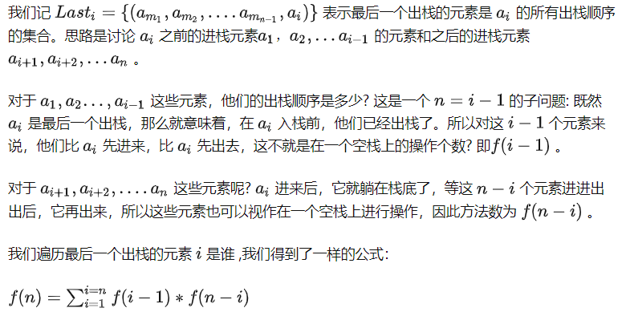
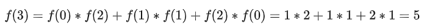
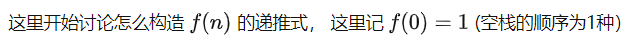
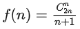
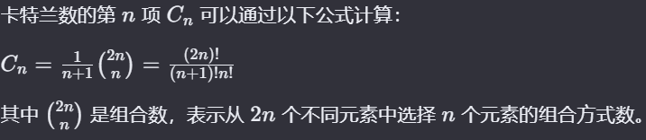

**图示标注**

a1、a2、an、a、b、c、A、B、C、D、E、…、0、…...、x、p、q

## 3.2 栈的应用

**定义**

思考？

**说明**

**将十进制用栈转化为八（十六）进制字符串输出**
**思考：小数如何处理？**
**（1）出现左括号，必有相应的右括号与之匹配**
**int Check( ) {**
**表达式的组成**
**讨论**
**设置两个工作栈**
**左括号之后第一个符号一定入栈**
**计算 2+4-3*6**
**Page**
**算法3.4 算术表达式求值的算符优先算法**
**计算**
**填空题**
**表达式**
**中缀表达式转后缀表达式的算法**
**求下述中缀表达式的后缀表达式**
**则由“a*b+c/d”得到“ab*cd/+”的操作序列为?**
**思路**
**B 进栈**
**C 进栈**
**a 出栈**
**b 进栈**
**c 进栈**
**d进栈**
**/出栈**
**Page**
- void conversion()//将十进制用栈转化为八进制{ SqStack S; int N; int e; InitStack(S); printf("输入N的值:"); scanf("%d",&N); printf(" 转换后的值:"); while(N) { Push(S, N % 8); N = N/8; } while(!StackEmpty(S)) { Pop(S,e); printf(" %d",e); }}
- 一、数制转换
- 课后上机练习
- 二、括号匹配检查
- 算术表达式中的括号： ...[...{...}...[...]...]...[...]...(...)..
- 使用规则：
- （2）每对括号之间可以嵌套，但不能出现交叉情况。
- 利用栈结构保存每个出现的左括号，当遇到右括号时，从栈中弹出左括号，检验匹配情况。
- （1）当遇到某一个右括号时，栈已空，说明到目前为止，右括号多于左括号；
- （2）从栈中弹出的左括号与当前检验的右括号类型不同，说明出现了括号交叉情况；
- （3）算术表达式输入完毕，但栈中还有没有匹配的左括号，说明左括号多于右括号。
- STACK S; //定义栈结构S
- char ch;
- InitStack(&S); //初始化栈S
- while ((ch=getchar())!=’\n’) {//以字符序列的形式输入表达式
- switch (ch) {
- case (ch==‘(’||ch== ‘[’||ch== ‘{’): Push(&S,ch);break; //遇左括号入栈
- //在遇到右括号时，分别检测匹配情
- case (ch== ‘)’): if (StackEmpty(S)) retrun FALSE;
- else {Pop(&S,&ch); if (ch!= ‘(’) return FALSE; } break;
- default:break;
- }//switch end
- }//while end
- if (StackEmpty(S)) return TRUE; else return FALSE;
- 三、表达式求值
- 操作数(operand)：常数、变量。
- 运算符(operator)：算术运算符、关系运算符和逻辑运算符。
- 界限符(delimiter) ：左右括弧和表达式结束符。
- 算术运算的规则
- 先乘除后加减=>运算符的优先级高低是相对的
- 先左后右=>左+>右+
- 先括弧内后括弧外：
- 左括号的优先级和其左/右侧运算符相比 (高|低?)
- 右括号的优先级与其左侧运算符相比最(？)
- 左右括号的优先级(?)
- 例如：2+4-3*6
- 例如：4+2*3-10/5 =4+6-10/5 =10-10/5 =10-2 =8
- 例如：4+(2+2*3/6)
- 如何用栈辅助计算表达式？
- 如何用栈控制运算顺序？
- 运算符的优先级什么时候确定？
- 高优先级运算符先入栈、出栈还是直接计算？
- 低优先级运算符先入栈、出栈还是直接计算？
- 什么时候涉及到计算？
- 如何用栈保存和运算符对应的操作数？
- 算法的思想：
- 运算符栈OPTR，运算符栈的栈底为表达式的起始符#。
- 操作数栈OPND，操作数栈为空栈。
- 读取符号
- 判断当前符号
- 若是操作数则进OPND栈；
- 若是运算符，则和OPTR中的栈顶元素做比较再操作。
- 若运算符优先级高于OPTR中的栈顶元素，则运算符入栈；读入下一符号;
- 若运算符优先级低于OPTR中的栈顶元素，则从OPND栈顶弹出两个操作数，与OPTR中的栈顶元素做运算，并将运算结果入OPND；
- 若运算符优先级等于OPTR中的栈顶元素:如果栈顶是左括号，则将OPTR中的栈顶元素出栈；读入下一符号;如果栈顶是#，结束,操作数栈顶是最终计算结果。(注意：右括号不进栈)
- #的优先级最高还是低？
- 遇到左括号一律入栈
- 遇到）一律出栈计算直到遇到（或者#
- 原则上不出现
- 表3.1
- 2 + 4 – 3 * 6
- 操作数
- 运算符
- 当前符号
- 2025/10/9
- 操作数
- 运算符
- 操作数
- 运算符
- 操作数
- 运算符
- 操作数
- 运算符
- 操作数
- 运算符
- OperandType EvaluateExpression(){//设OPTR和OPND分别为运算符栈和运算数栈，OP为运算符集合。
- InitStack(OPTR); Push(OPTR,’#’);
- InitStack(OPND);
- c=getchar();
- while(c!=‘#’ || GetTop(OPTR)!= ‘#’ ){//当前符号是#并且栈顶也是#时结束 if(!In(c,OP)) {Push(OPND,c); c=getchar();}//是操作数 else switch (Precede(GetTop(OPTR),c)){ case ‘<’://栈顶元素优先权低 Push(OPTR,c); c=getchar();break; case ‘=’://优先权相等，脱括号并接收下一个字符 Pop(OPTR,x); c=getchar();break; case ‘>’://栈顶元素优先权高，退栈并将运算结果入栈 Pop(OPTR,theta); Pop(OPND,b); Pop(OPND, a); Push(OPND,Operate(a,theta,b));break; }//switch}//while
- return GetTop(OPND);//操作数栈顶上保存的就是最终结果
- }//EvaluateExpression
- 4 + 2 * 3 – 10 / 5
- 操作数
- 运算符
- 当前符号
- 4 + ( 2 + 2 * 3 / 6 )+3
- 操作数
- 运算符
- 当前符号
- 请写出表达式(1+2*3-4/(5-6))/(7*8)当扫描到字符7的时候，运算符栈中的内容（由栈底到栈顶依次写出，用空格隔开）
- [填空1]
- 10分
- 中缀表达式： a*b+c/d
- 前缀表达式：+*ab/cd
- 后缀表达式（逆波兰表达式）：ab*cd/+
- 后缀表达式的优点：便于计算
- 遇到操作数，则进栈
- 遇到操作符，则弹出操作数并把计算结果进栈
- 无界限符
- 压入#
- 遇到数字：直接输出
- 遇到'('：压栈
- 遇到‘)’：持续出栈至'(' ，如果出栈的符号不是‘(’则输出，否则终止出栈。 左括号不输出
- 遇到符号则判断该符号与栈顶符号的运算优先级，将高于等于当前符号的符号全部依次弹出，然将当前符号入栈。
- 处理完字符串后将栈中剩余的符号全部输出。
- 示例：a * b + c / d
- 特点：所有操作数原顺序输出
- a*b+c
- a*b/c
- a*b*c*d*e*f
- a+(b*c+d)/e
- 假设S和X分别表示进栈和出栈操作，由输入序列“ABC”得到输出序列“BCA”的操作序列为SSXSXX，
- 使用辅助栈
- A：依次读入输入序列，输出S，并入栈
- GetTop 判断栈顶符号是否是当前输出符号
- 如果是，则出栈，输出符号下移，重复该判断
- 如果不是，则读入下一输入序列符号并进行相应操作
- base
- top
- top
- base
- top=base
- 操作序列：
- A 进栈
- B 出栈
- top
- base
- top
- base
- top
- base
- 输出：B
- 操作序列：S S X
- C 出栈
- A 出栈
- base
- top
- 操作序列：
- a 进栈
- * 进栈
- 输出：a
- top
- base
- top
- base
- top
- base
- 输出：a
- 操作序列：S X S
- b 出栈
- * 出栈
- base
- top
- 操作序列：S X S S X X
- + 进栈
- c出栈
- 输出：a b *
- top
- base
- 操作序列：S X S S X X S S X
- /进栈
- d出栈
- 输出：a b * c
- top
- base
- base
- top
- top
- base
- 操作序列：S X S S X X S S X S S X
- + 出栈
- 输出：a b * c d
- base
- top
- top
- base
- 当一个函数在运行期间调用另一个函数时，在运行该被调用函数之前，需先完成三件事：
- 将所有的实在参数、返回地址等信息传递给被调用函数保存；
- 为被调用函数的局部变量分配存储区；
- 将控制转移到被调用函数的入口。
- 而从被调用函数返回调用函数之前，应该完成：
- 保存被调函数的计算结果；
- 释放被调函数的数据区；
- 依照被调函数保存的返回地址将控制转移到调用函数。
- 由于函数的运行规则是：后调用先返回，因此各函数占有的存储管理应实行"栈式管理"。
- 主程序
- 子过程1
- 子过程2
- 子过程3
- 有A,B,C三个塔座，A上套有n个直径不同的圆盘，按直径从小到大叠放，形如宝塔,编号1,2,3……n。要求将n个圆盘从A移到C，叠放顺序不变，移动过程中遵循下列原则：
- 每次只能移一个圆盘；
- 圆盘可在三个塔座上任意移动；
- 任何时刻，每个塔座上不能将大盘压到小盘上。
- 问题描述
- 解决方法：
- n=1时，直接把圆盘从A移到C。
- n>1时
- 把上面n-1个圆盘从A移到B
- 然后将n号盘从A移到C
- 将n-1个盘从B移到C。
- 即把求解n个圆盘的Hanoi问题转化为求解n-1个圆盘的Hanoi问题，依次类推，直至转化成只有一个圆盘的Hanoi问题。
- main()
- { int m;
- printf("Input number of disks”);
- scanf("%d",&m);
- printf(”Steps : %3d disks”,m);
- hanoi(m,'A','B','C');
- (0) }
- void hanoi(int n,char x,char y,char z)
- (1) {
- (2) if(n==1)
- (3) move(1,x,z);
- (4) else{
- (5) hanoi(n-1,x,z,y);
- (6) move(n,x,z);
- (7) hanoi(n-1,y,x,z);
- (8) }
- (9) }
- main()
- { int m;
- (0) }
- (1) {
- (8) }
- (9) }
- 3 A B C 0
- 2 A C B 6
- 1 A B C 6
- main()
- { int m;
- printf("Input the number of disks
- printf("The steps to moving %3d
- (0) }
- (1) {
- (8) }
- (9) }
- 1 C A B 8
- main()
- { int m;
- (0) }
- (1) {
- (8) }
- (9) }
- 2 B A C 8
- 1 B C A 6
- main()
- { int m;
- (0) }
- (1) {
- (8) }
- (9) }
- 1 A B C 8

**表格**

| n | x | y | z | addr |
| --- | --- | --- | --- | --- |

**图示**

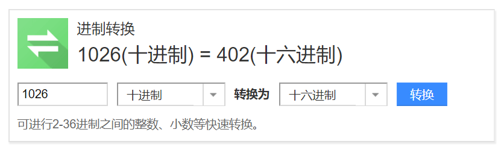
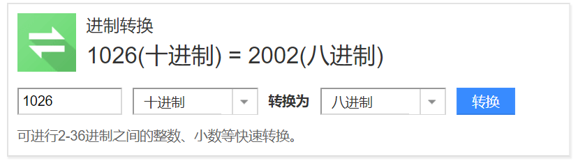
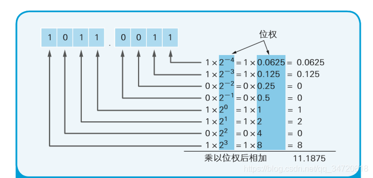
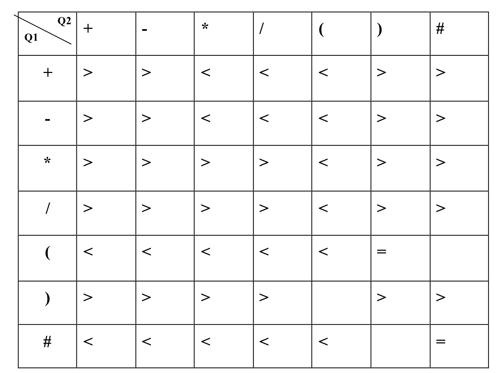
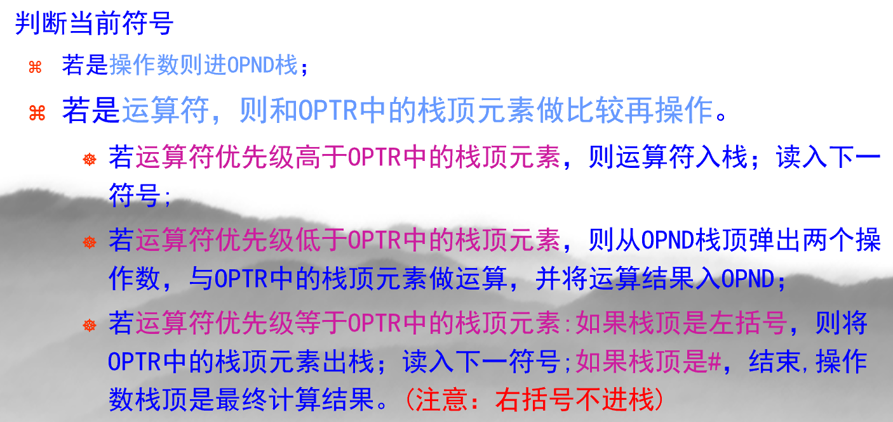

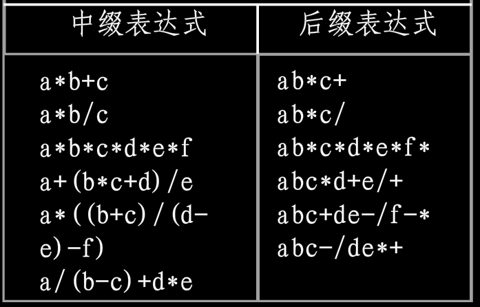

**图示标注**

2、4、6、-、3、18、A、B、S、X、C、a、b、c、d、r、s、t、1

### 3.2.2 队列

**概念**

队列是一种先进先出（FIFO）的线性表：只允许在一端进行插入，而在另一端进行删除。允许插入的一端称为队尾，允许删除的一端称为队头。若队列中的元素依次为 a1、a2、…、an，则 a1 端为队头，an 端为队尾，出队顺序与入队顺序一致。
作为线性表的一种受限形式，队列的数据对象与数据关系同一般线性表相同：D＝{ai | ai∈ElemSet, i=1,2,…,n, n≥0}，R1＝{ <a_{i-1}, a_i> | a_{i-1}, a_i ∈D, i=2,…,n}，区别只在于插入和删除被限制在两端。
队列的主要基本操作有：InitQueue(&Q) 构造一个空队列；DestroyQueue(&Q) 销毁已存在的队列；QueueEmpty(Q) 判空；QueueLength(Q) 求长度；GetHead(Q,&e) 取队头元素；EnQueue(&Q,e) 入队，在队尾插入元素 e；DeQueue(&Q,&e) 出队，删除队头元素并用 e 返回；QueueTravers(Q,visit()) 遍历队列。

**为什么需要**

顺序队列用一组地址连续的存储单元依次存放从队头到队尾的元素，front 和 rear 分别指示队头和队尾的下一个元素，初始令 front = rear = 0 表示空队列，每插入一个元素 rear 增 1，每删除一个元素 front 增 1。
这样做的直接后果是：随着插入和删除的交替进行，front 与 rear 只会单调后移。例如先插入 J1，再插入 J2、J3，然后删除 J1、J2，接着插入 J4、J5、J6，此时 rear 已到达存储区的末端而判为队满，无法再插入新元素，但前面的单元因为已经出队而空着，可用空间并未真的被占满。这种“有空间却插不进”的现象来自指针不能回退，而不是元素真的填满了数组。
解决思路是把顺序队列的存储区从一条直线改造成一个环，即循环队列：让 rear 和 front 都按模 maxsize 的方式前进，越过末端后回到开头，从而重复利用出队后腾出的单元。

**怎么用**

链队列是队列的链式存储结构，队列的链式表示必须同时具备指示队头和队尾的指针，并附设一个头结点。结点与队列的类型定义如下：
typedef struct QNode {
    QElemType data;
    struct QNode *next;
} QNode, *QueuePtr;

typedef struct {
    QueuePtr front;   // 队头指针
    QueuePtr rear;    // 队尾指针
} LinkQueue;
入队操作在队尾插入新元素 e：申请新结点并置 p->data = e、p->next = NULL，再把它挂到当前尾结点之后并让尾指针指向它。
p = (QueuePtr) malloc(sizeof(QNode));
if (!p) exit(OVERFLOW);
p->data = e;
p->next = NULL;      // 申请新结点
Q.rear->next = p;
Q.rear = p;          // 插入在队尾
return OK;
出队操作删除队头元素（即头结点之后的第一个结点）：
if (Q.front == Q.rear) return ERROR;   // 空队列
p = Q.front->next;                     // 第一个结点
e = p->data;                           // 取出队头元素
Q.front->next = p->next;               // 从链上摘下该结点
if (Q.rear == p) Q.rear = Q.front;     // 被删结点正是尾结点时，尾指针退回
free(p);
return OK;
循环队列把顺序存储区首尾相接，令 front = rear = 0 表示空队列；每插入一个新元素执行 rear = (rear + 1) % maxsize，每删除一个元素执行 front = (front + 1) % maxsize，其中 % 为求余运算。
循环队列的判据需要单独约定：队空是 Q.front == Q.rear；由于在环上“转满一圈”时也有 front == rear，所以不能再用 front == rear == 0 来分辨队空与队满。常用的解决办法是牺牲一个存储单元，规定 front 与 rear 之间总空出一格，此时队满条件为 Q.front == (Q.rear + 1) % maxsize，队列中最多存放 maxsize - 1 个元素。也可以额外记录元素个数或设标志位来区分，但那要另加存储或状态。

**例子**

二项式系数（杨辉三角）可以用循环队列逐行生成。表的开头几行为：第 1 行 1 1；第 2 行 1 2 1；第 3 行 1 3 3 1；第 4 行 1 4 6 4 1。这个表在我国称为贾宪三角或杨辉三角，在欧洲称为帕斯卡三角形。
用队列计算的关键是递推关系：设第 i-1 行的值为（a[0]=0）a[1]…a[i]（a[i+1]=0），即在行两端各补一个 0，则第 i 行的值为 b[j] = a[j-1] + a[j]，j = 1,2,…,i+1。把上一行的数依次出队，每出队两个相邻的数就得到下一行的一个数，再把它入队，行末需要补的 0 也在此时加入，于是队列中滚动保存的始终是当前正在生成的那一行。
由于每行的数在生成后立即入队而旧的数已出队，队列长度只需容纳一行即可；行数不多时，按最大行长度取一个足够小的容量就能演示整个计算过程。
这个表本身还有可观察的规律：最外层恒为 1，第二层是自然数列，第三层是三角数列，斐波那契数列也可以由斜向求和得到，这些规律与循环队列的滚动计算相互印证。

**易错**

循环队列中 front 与 rear 的含义要统一：它们指示的是队头元素和队尾元素的下一个位置，因此队满时 rear 指向的是那个被牺牲的空单元，而不是最后一个元素所在处。
若按 front == rear 判定队满，就会与队空条件冲突；采用“空出一格”的方案时，队满条件是 Q.front == (Q.rear + 1) % maxsize，可用元素个数为 maxsize - 1，不要误以为能存满 maxsize 个。
链队列出队时必须处理被删结点恰好是尾结点的情况：若只做 Q.front->next = p->next 就 free(p)，尾指针 Q.rear 会指向已释放的结点而成为悬空指针，后续入队立即出错，所以要先判断 Q.rear == p 并令 Q.rear = Q.front。
顺序队列不做成环时，仅凭 rear 是否到达数组末端来判断队满是不够的：出现“队头前有空位而仍报队满”的假溢出，说明判定依据应是元素个数或环形移动，而不是指针的绝对位置。
